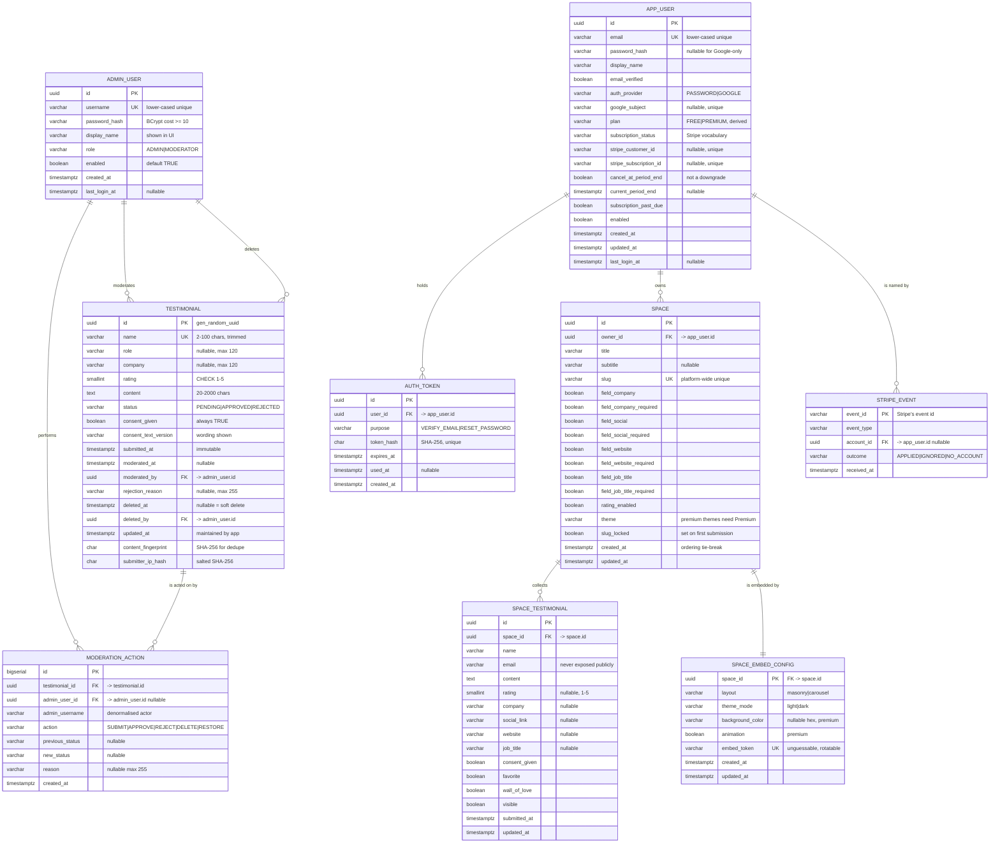

# LoveProof — Data Model

**Version:** 1.3 (implemented — V1–V7 applied and validated)
**Database:** PostgreSQL 16
**Schema owner:** `loveproof` (application user, least privilege)
**Migration tooling:** Flyway (`backend/src/main/resources/db/migration`)

---

## 1. Design Overview

The model has two halves that coexist. The **single-tenant** half is the original wall; the
**SaaS** half is the multi-tenant product, where a signed-in user owns Spaces.

### The single-tenant half

| Table | Purpose | Rough cardinality |
|---|---|---|
| `testimonial` | Every submission and its moderation state | 1 row per submission |
| `admin_user` | Accounts permitted to moderate | 1–N rows (1 seeded in v1) |
| `moderation_action` | Append-only audit trail of every moderation decision | 0–N rows per testimonial |

### The SaaS half

| Table | Purpose | Rough cardinality |
|---|---|---|
| `app_user` | A customer account, its plan and its Stripe identifiers | 1 row per customer |
| `auth_token` | Single-use, expiring email-verification and password-reset tokens | 0–N rows per account |
| `space` | A collection page a customer owns | 1–N rows per account |
| `space_testimonial` | A testimonial collected by one Space | 0–N rows per Space |
| `space_embed_config` | One embed configuration per Space | 1 row per Space |
| `stripe_event` | The webhook ledger — one row per delivered Stripe event | 1 row per event |

Four design rules shape everything else:

1. **Status and deletion are orthogonal.** `status` carries the moderation decision (`PENDING`,
   `APPROVED`, `REJECTED`); `deleted_at` carries the independent soft-delete flag. A deleted testimonial
   keeps its last moderation status so the audit history stays meaningful, but it is excluded from the
   wall and from every count except the explicitly labelled "deleted" count.
2. **Counts are derived, never stored.** There is no counter table and no cached aggregate. Dashboard
   numbers come from `COUNT(*)`/`AVG()` queries at request time, so they cannot drift out of sync with the
   underlying rows.
3. **The plan is derived, not decided.** `app_user.plan` is a convenience column, but it is always
   written from `subscription_status` by one method (`AppUser.applySubscriptionState`). The status is
   the authority; the plan cannot be set independently of it.
4. **The ledger's primary key is the idempotency guard.** `stripe_event.event_id` is Stripe's own
   event identifier. Stripe delivers events more than once and out of order; a replay cannot be
   inserted, so its transaction rolls back and no effect is applied twice.

---

## 2. Entity Reference

### 2.1 `testimonial`

The core entity. One row per public submission.

| Field | Type | Null | Default | Constraints / Notes |
|---|---|---|---|---|
| `id` | `uuid` | no | `gen_random_uuid()` | PK. Client-visible opaque identifier. |
| `name` | `varchar(100)` | no | — | Trimmed on write. Length 2–100 enforced by CHECK **and** bean validation. |
| `role` | `varchar(120)` | yes | — | Job title. Trimmed; empty string normalised to `NULL`. |
| `company` | `varchar(120)` | yes | — | Trimmed; empty string normalised to `NULL`. |
| `rating` | `smallint` | no | — | CHECK `rating BETWEEN 1 AND 5`. No half-stars. |
| `content` | `text` | no | — | Plain text, 20–2000 chars, trimmed. Never rendered as HTML. |
| `status` | `varchar(16)` | no | `'PENDING'` | CHECK `IN ('PENDING','APPROVED','REJECTED')`. |
| `consent_given` | `boolean` | no | — | Must be `true` at creation (CHECK enforced at DB level). |
| `consent_text_version` | `varchar(32)` | no | — | Identifies the consent wording shown at submission time, e.g. `v1`. |
| `submitted_at` | `timestamptz` | no | `now()` | Set once on insert; never changed. |
| `moderated_at` | `timestamptz` | yes | `NULL` | Timestamp of the most recent moderation decision. |
| `moderated_by` | `uuid` | yes | `NULL` | FK → `admin_user(id)` `ON DELETE SET NULL`. |
| `rejection_reason` | `varchar(255)` | yes | `NULL` | Set when status is `REJECTED`. |
| `deleted_at` | `timestamptz` | yes | `NULL` | Soft-delete marker. `NULL` = live. |
| `deleted_by` | `uuid` | yes | `NULL` | FK → `admin_user(id)` `ON DELETE SET NULL`. |
| `updated_at` | `timestamptz` | no | `now()` | Maintained by application on every update. |
| `content_fingerprint` | `char(64)` | no | — | SHA-256 of `name` + normalised `content`. Backs the duplicate check (FR-1.13). |
| `submitter_ip_hash` | `char(64)` | yes | `NULL` | Salted SHA-256 of the client IP. Never the raw IP. |

**Derived / computed (not columns):** `averageRating` across approved testimonials, `pendingCount`,
`approvedCount`, `rejectedCount`, `deletedCount`, `last7DaysCount`.

**Deliberately absent:** `email`, `author_ip` (raw), `updated_by` on non-moderation edits, `view_count`,
`featured`, `slug`. Rationale in A-2, A-4 and A-9 of the requirements document.

#### Check constraints

| Name | Definition | Purpose |
|---|---|---|
| `ck_testimonial_rating_range` | `rating >= 1 AND rating <= 5` | Enforces the 1–5 scale at DB level. |
| `ck_testimonial_status` | `status IN ('PENDING','APPROVED','REJECTED')` | Prevents invalid states from any writer. |
| `ck_testimonial_name_length` | `char_length(btrim(name)) BETWEEN 2 AND 100` | Mirrors bean validation so non-JPA writers cannot bypass it. |
| `ck_testimonial_content_length` | `char_length(btrim(content)) BETWEEN 20 AND 2000` | Same. |
| `ck_testimonial_role_length` | `role IS NULL OR char_length(btrim(role)) <= 120` | Same. |
| `ck_testimonial_company_length` | `company IS NULL OR char_length(btrim(company)) <= 120` | Same. |
| `ck_testimonial_consent_required` | `consent_given = TRUE` | Consent can never be withdrawn by editing the row to `false`. |
| `ck_testimonial_rejection_reason` | `(status = 'REJECTED' AND rejection_reason IS NOT NULL) OR (status <> 'REJECTED')` | A rejection always carries a reason. |
| `ck_testimonial_moderation_fields` | `(status = 'PENDING' AND moderated_at IS NULL) OR (status <> 'PENDING' AND moderated_at IS NOT NULL)` | Pending means untouched. |

#### Indexes

| Index | Columns | Type | Serves |
|---|---|---|---|
| `pk_testimonial` | `id` | B-tree | PK. |
| `idx_testimonial_status_submitted` | `(status, submitted_at DESC)` | B-tree | Moderation inbox ordering; per-status counts. |
| `idx_testimonial_live_approved` | `(submitted_at DESC)` | **Partial**: `WHERE status = 'APPROVED' AND deleted_at IS NULL` | Public wall — keeps the index small regardless of queue size. |
| `idx_testimonial_rating_approved` | `(rating)` | **Partial**: `WHERE status = 'APPROVED' AND deleted_at IS NULL` | Wall filter by rating. |
| `idx_testimonial_fingerprint` | `(content_fingerprint)` | B-tree | Duplicate detection. |
| `idx_testimonial_submitter` | `(submitter_ip_hash, submitted_at DESC)` | B-tree | Per-IP rate-limit bookkeeping and abuse review. |
| `idx_testimonial_deleted_at` | `(deleted_at)` | B-tree | Fast exclusion of soft-deleted rows. |

**Composite indexes for the wall (migration `V4`).** The wall is the busiest read in the
application, and its two orderings each need the sort column together with the filter columns in
a single index. Without them the planner reads every approved row and sorts them to return the
first page.

| Index | Columns | Type | Serves |
|---|---|---|---|
| `idx_testimonial_live_approved_recent` | `(submitted_at DESC, rating DESC)` | **Partial**: `WHERE status = 'APPROVED' AND deleted_at IS NULL` | The wall's "newest first" ordering. |
| `idx_testimonial_live_approved_rating` | `(rating DESC, submitted_at DESC)` | **Partial**: `WHERE status = 'APPROVED' AND deleted_at IS NULL` | The wall's "highest rated" ordering. The submission time is the tie-breaker, so the ordering is total and two rows with the same rating always come back in the same order. |
| `idx_testimonial_live_approved_rating_filter` | `(rating, submitted_at DESC)` | **Partial**: `WHERE status = 'APPROVED' AND deleted_at IS NULL AND consent_given = TRUE` | The wall filtered by rating. |

All three share the baseline partial predicate, so they stay small however large the moderation
queue grows: a pending or deleted row is in none of them.

With these in place the wall read is a direct index scan returning exactly the rows the page
needs — 0.09 ms over 1,000 rows, against a top-N heapsort over every approved row before.
`WallPerformanceTest` asserts the plan uses an index scan and never a sequential scan.

#### Relationships

- `testimonial.moderated_by` → `admin_user.id` (many-to-one, nullable)
- `testimonial.deleted_by` → `admin_user.id` (many-to-one, nullable)
- `testimonial` → `moderation_action` (one-to-many via `moderation_action.testimonial_id`)

---

### 2.2 `admin_user`

| Field | Type | Null | Default | Constraints / Notes |
|---|---|---|---|---|
| `id` | `uuid` | no | `gen_random_uuid()` | PK. |
| `username` | `varchar(50)` | no | — | **Unique.** Case-insensitive unique (stored lower-cased). |
| `password_hash` | `varchar(100)` | no | — | BCrypt hash, cost ≥ 10. Never logged, never returned by any endpoint. |
| `display_name` | `varchar(100)` | no | — | Shown in the admin header, e.g. "Course Admin". |
| `role` | `varchar(16)` | no | `'ADMIN'` | CHECK `IN ('ADMIN','MODERATOR')`. Only `ADMIN` may log in to the admin area in v1 (A-3). |
| `enabled` | `boolean` | no | `true` | Disabled users cannot authenticate. |
| `created_at` | `timestamptz` | no | `now()` | — |
| `last_login_at` | `timestamptz` | yes | `NULL` | Updated on successful authentication. |

**Check constraints:** `ck_admin_user_role` on `role`; `ck_admin_user_password_hash` requires a
non-blank hash.

**Indexes:** `uq_admin_user_username` (unique, b-tree on `lower(username)`), `pk_admin_user`.

---

### 2.3 `moderation_action`

Append-only audit log. Rows are inserted, never updated, never hard-deleted.

| Field | Type | Null | Default | Constraints / Notes |
|---|---|---|---|---|
| `id` | `bigserial` | no | — | PK. Monotonic ordering for stable tie-breaks. |
| `testimonial_id` | `uuid` | no | — | FK → `testimonial(id)` `ON DELETE CASCADE`. |
| `admin_user_id` | `uuid` | yes | `NULL` | FK → `admin_user(id)` `ON DELETE SET NULL`. Nulled if the admin row is removed; the action text remains. |
| `admin_username` | `varchar(50)` | no | — | Denormalised copy of the actor's username, so the audit trail survives admin deletion. |
| `action` | `varchar(16)` | no | — | CHECK `IN ('SUBMIT','APPROVE','REJECT','DELETE','RESTORE')`. |
| `previous_status` | `varchar(16)` | yes | `NULL` | Status before the action, for replay/audit. |
| `new_status` | `varchar(16)` | yes | `NULL` | Status after the action. |
| `reason` | `varchar(255)` | yes | `NULL` | Rejection reason or delete note. |
| `created_at` | `timestamptz` | no | `now()` | Action timestamp. |

**Check constraints:** `ck_moderation_action_action` on the `action` vocabulary; `ck_moderation_action_status`
ensuring `previous_status`/`new_status` are `NULL` or valid status values.

**Indexes:** `idx_moderation_action_testimonial` on `(testimonial_id, created_at DESC)`;
`idx_moderation_action_created_at` on `(created_at DESC)`.

> `SUBMIT` is recorded on creation so the audit trail covers the full lifecycle, not just moderation.

---

## 2.4 `app_user`

The customer account. Introduced by `V5`, with the billing columns added by `V7`.

| Field | Type | Null | Default | Constraints / Notes |
|---|---|---|---|---|
| `id` | `uuid` | no | `gen_random_uuid()` | PK. |
| `email` | `varchar(254)` | no | — | Stored lower-cased, so the unique index is case-insensitive. |
| `password_hash` | `varchar(100)` | yes | `NULL` | BCrypt. `NULL` for a Google-only account; the column exists so a password can be set later without a migration. |
| `display_name` | `varchar(100)` | no | — | Shown in the header. |
| `email_verified` | `boolean` | no | `FALSE` | Google users are verified from the outset; email/password users must click the emailed link. |
| `auth_provider` | `varchar(16)` | no | `'PASSWORD'` | CHECK `IN ('PASSWORD','GOOGLE')`. Both may be set over time — a user who registers with a password and later signs in with Google keeps **one** account. |
| `google_subject` | `varchar(255)` | yes | `NULL` | Unique when present. One Google identity maps to exactly one account. |
| `plan` | `varchar(16)` | no | `'FREE'` | CHECK `IN ('FREE','PREMIUM')`. **Derived** from `subscription_status`; only the webhook and the reconciliation job write it. |
| `subscription_status` | `varchar(32)` | no | `'NONE'` | Stripe's own vocabulary, verbatim. CHECK `IN ('NONE','active','trialing','past_due','canceled','unpaid','incomplete','incomplete_expired','paused')`. |
| `stripe_customer_id` | `varchar(255)` | yes | `NULL` | Unique when present. Used for the billing portal. |
| `stripe_subscription_id` | `varchar(255)` | yes | `NULL` | Unique when present. A subscription belongs to exactly one account. |
| `cancel_at_period_end` | `boolean` | no | `FALSE` | Set when the customer cancelled but the paid period has not ended. **Not** a downgrade. |
| `current_period_end` | `timestamptz` | yes | `NULL` | When the paid period ends. |
| `subscription_past_due` | `boolean` | no | `FALSE` | Set when a renewal failed and Stripe is still retrying. Premium access continues. |
| `enabled` | `boolean` | no | `TRUE` | A disabled account cannot sign in. |
| `created_at` / `updated_at` | `timestamptz` | no | `now()` | — |
| `last_login_at` | `timestamptz` | yes | `NULL` | — |

#### Check constraints

| Name | Definition | Purpose |
|---|---|---|
| `ck_app_user_plan` | `plan IN ('FREE','PREMIUM')` | The plan vocabulary. |
| `ck_app_user_auth_provider` | `auth_provider IN ('PASSWORD','GOOGLE')` | The sign-in methods. |
| `ck_app_user_password_present` | `auth_provider = 'GOOGLE' OR password_hash IS NOT NULL` | A Google-only account is expressed by the provider, not by a null hash on a `PASSWORD` account. |
| `ck_app_user_password_hash` | `password_hash IS NULL OR btrim(password_hash) <> ''` | An empty hash is never a hash. |
| `ck_app_user_email_length` | `char_length(btrim(email)) BETWEEN 3 AND 254` | Mirrors bean validation. |
| `ck_app_user_display_name_length` | `char_length(btrim(display_name)) BETWEEN 1 AND 100` | Same. |
| `ck_app_user_subscription_status` | `subscription_status IN (…)` | The status vocabulary, so no writer can invent one. |

#### Indexes

| Index | Columns | Type | Serves |
|---|---|---|---|
| `uq_app_user_email` | `lower(email)` | Unique b-tree | Sign-in and account lookup, case-insensitively. |
| `uq_app_user_google_subject` | `google_subject` | Unique b-tree, partial | One Google identity → one account. |
| `uq_app_user_stripe_customer` | `stripe_customer_id` | Unique b-tree, partial | One Stripe customer → one account. |
| `uq_app_user_stripe_subscription` | `stripe_subscription_id` | Unique b-tree, partial | **One subscription belongs to exactly one account.** The uniqueness is what stops a second account from claiming the same subscription and taking over its plan. |

> **The plan is a pure function of the status.** `PREMIUM ⇔ status ∈ {active, trialing,
> past_due}`. `cancel_at_period_end` never downgrades, so cancelling keeps Premium until the period
> ends; a failed renewal shows "past due" and keeps Premium; only `canceled` or `unpaid` ends the
> subscription. One method applies a whole subscription state, and both the webhook and the
> reconciliation job go through it, so the two can never disagree.

---

## 2.5 `auth_token`

Single-use, expiring tokens for email verification and password reset. Both flows need the same
properties — one use, a deadline, and a link the user cannot guess — so they share one table and
differ by `purpose`.

| Field | Type | Null | Default | Constraints / Notes |
|---|---|---|---|---|
| `id` | `uuid` | no | `gen_random_uuid()` | PK. |
| `user_id` | `uuid` | no | — | FK → `app_user(id)` `ON DELETE CASCADE`. |
| `purpose` | `varchar(16)` | no | — | CHECK `IN ('VERIFY_EMAIL','RESET_PASSWORD')`. |
| `token_hash` | `char(64)` | no | — | SHA-256 of the token. The plaintext only ever exists in the emailed link, so a database leak does not hand over working reset links. |
| `expires_at` | `timestamptz` | no | — | The deadline. |
| `used_at` | `timestamptz` | yes | `NULL` | Set on use. A used token is never used again. |
| `created_at` | `timestamptz` | no | `now()` | — |

**Indexes:** `uq_auth_token_hash` (unique, on `token_hash`) and `idx_auth_token_user_purpose` on
`(user_id, purpose)`.

---

## 2.6 `space`

A collection page. One account owns many; each has its own public URL and its own form
configuration.

| Field | Type | Null | Default | Constraints / Notes |
|---|---|---|---|---|
| `id` | `uuid` | no | `gen_random_uuid()` | PK. |
| `owner_id` | `uuid` | no | — | FK → `app_user(id)` `ON DELETE CASCADE`. |
| `title` | `varchar(120)` | no | — | CHECK length 1–120. |
| `subtitle` | `varchar(255)` | yes | `NULL` | — |
| `slug` | `varchar(80)` | no | — | The public URL segment, `/s/{slug}`. CHECK `^[a-z0-9]+(-[a-z0-9]+)*$`. **Unique across the platform**, so a link can never be ambiguous. |
| `field_company` / `field_company_required` | `boolean` | no | `FALSE` | Whether the company field is collected, and whether it is required. |
| `field_social` / `field_social_required` | `boolean` | no | `FALSE` | Same. |
| `field_website` / `field_website_required` | `boolean` | no | `FALSE` | Same. |
| `field_job_title` / `field_job_title_required` | `boolean` | no | `FALSE` | Same. |
| `rating_enabled` | `boolean` | no | `FALSE` | Whether the public form shows a rating control. |
| `theme` | `varchar(32)` | no | `'basic'` | The theme key. Premium themes need Premium; the backend refuses a Free account choosing one. |
| `slug_locked` | `boolean` | no | `FALSE` | Set once the Space receives its first submission, after which the slug can no longer change. |
| `created_at` / `updated_at` | `timestamptz` | no | `now()` | The ordering tie-break for "the oldest Spaces stay editable". |

**Check constraints:** `ck_space_title_length`, `ck_space_subtitle_length`, `ck_space_slug_format`,
`ck_space_slug_length`, and `ck_space_optional_field_required` — a field that is required must also
be enabled, because a required field that is not collected could never be answered.

**Indexes:** `uq_space_slug` (unique) and `idx_space_owner_created` on `(owner_id, created_at DESC)`.

> **The "oldest N stay editable" rule needs a total order.** `created_at` alone is not one — two
> Spaces created in the same millisecond have equal timestamps, and the tie-break would be
> arbitrary. The ordering is therefore `created_at ASC, id ASC`, which is stable.

---

## 2.7 `space_testimonial`

A testimonial collected by one Space.

| Field | Type | Null | Default | Constraints / Notes |
|---|---|---|---|---|
| `id` | `uuid` | no | `gen_random_uuid()` | PK. |
| `space_id` | `uuid` | no | — | FK → `space(id)` `ON DELETE CASCADE`. |
| `name` | `varchar(100)` | no | — | CHECK length 1–100. |
| `email` | `varchar(254)` | no | — | The submitter's email. Never exposed publicly, and not in the owner's own inbox — the inbox shows what they need to curate. |
| `content` | `text` | no | — | CHECK length 1–2000. |
| `rating` | `smallint` | yes | `NULL` | Nullable, because a Space can have ratings off. Otherwise 1–5. |
| `company` | `varchar(120)` | yes | `NULL` | — |
| `social_link` | `varchar(500)` | yes | `NULL` | One URL per submission. |
| `website` | `varchar(500)` | yes | `NULL` | — |
| `job_title` | `varchar(120)` | yes | `NULL` | — |
| `consent_given` | `boolean` | no | `FALSE` | Optional and never gates display. |
| `favorite` | `boolean` | no | `FALSE` | The owner's curation. |
| `wall_of_love` | `boolean` | no | `FALSE` | The subset the embed shows. |
| `visible` | `boolean` | no | `TRUE` | Hidden testimonials stay in the owner's inbox but not in the embed. |
| `submitted_at` | `timestamptz` | no | `now()` | Immutable. |
| `updated_at` | `timestamptz` | no | `now()` | Maintained by the application. |

**Indexes:** `idx_space_testimonial_inbox` on `(space_id, favorite DESC, submitted_at DESC)`;
`idx_space_testimonial_embed` on `(space_id, submitted_at DESC)` **partial** on
`wall_of_love = TRUE AND visible = TRUE`; `idx_space_testimonial_space_email` on
`(space_id, lower(email))` for unique-submitter counts; `idx_space_testimonial_submitted` on
`(submitted_at DESC)` for the dashboard chart.

> **There is no approval step.** A submission is visible by default, not on the Wall of Love and
> not a favourite. The owner curates it.

---

## 2.8 `space_embed_config`

One embed configuration per Space.

| Field | Type | Null | Default | Constraints / Notes |
|---|---|---|---|---|
| `space_id` | `uuid` | no | — | PK **and** FK → `space(id)` `ON DELETE CASCADE`. One configuration per Space. |
| `layout` | `varchar(32)` | no | `'masonry'` | CHECK `IN ('masonry','carousel')`. `carousel` needs Premium. |
| `theme_mode` | `varchar(16)` | no | `'light'` | CHECK `IN ('light','dark')`. |
| `background_color` | `varchar(7)` | yes | `NULL` | Premium only. A hex colour when present. `NULL` means the embed uses its own default. |
| `animation` | `boolean` | no | `FALSE` | Premium only. |
| `embed_token` | `varchar(64)` | no | — | The public token the embed script uses. **Unique.** |
| `created_at` / `updated_at` | `timestamptz` | no | `now()` | — |

> **The token is not derived from the slug.** An embed is a public URL that ends up in the page
> source of somebody else's website, so it is unguessable, and it can be rotated without changing
> the Space's address. The configuration lives on the server rather than inside the snippet, so
> changing it must not require the owner to paste a new snippet.

> **Premium options are refused on *choosing*, not on *holding*.** A downgraded owner keeps the
> premium settings they already had; what is refused is choosing a premium value in a new
> request. The validation only runs when the field is present in the request.

---

## 2.9 `stripe_event`

The webhook ledger. One row per delivered Stripe event. Introduced by `V7`.

| Field | Type | Null | Default | Constraints / Notes |
|---|---|---|---|---|
| `event_id` | `varchar(255)` | no | — | **PK.** Stripe's own event identifier. The uniqueness is the idempotency guard. |
| `event_type` | `varchar(64)` | no | — | e.g. `customer.subscription.updated`. |
| `account_id` | `uuid` | yes | `NULL` | FK → `app_user(id)` `ON DELETE SET NULL`. Null when the event named no known account. |
| `outcome` | `varchar(32)` | no | — | CHECK `IN ('APPLIED','IGNORED','NO_ACCOUNT')`. The column records what the event *did*, so the ledger explains itself. |
| `received_at` | `timestamptz` | no | `now()` | When the delivery arrived. |

**Indexes:** `pk_stripe_event` (PK) and `idx_stripe_event_received_at` on `(received_at)`.

> **The ledger row is written in the same transaction as the effect.** A replayed event cannot be
> inserted, its transaction rolls back, and no effect is applied twice — while the endpoint still
> answers `200`, so Stripe does not retry it.

---

## 3. Entity Relationship Diagram



---

## 4. Relationship Summary

| From | To | Cardinality | FK | On delete | Notes |
|---|---|---|---|---|---|
| `admin_user` | `testimonial` (as moderator) | 1 : N | `testimonial.moderated_by` | `SET NULL` | A moderator may have moderated many testimonials; deleting the admin keeps the testimonial, clearing the pointer. |
| `admin_user` | `testimonial` (as deleter) | 1 : N | `testimonial.deleted_by` | `SET NULL` | Same semantics for the soft-delete actor. |
| `testimonial` | `moderation_action` | 1 : N | `moderation_action.testimonial_id` | `CASCADE` | If a testimonial is ever hard-purged, its audit rows go with it. |
| `admin_user` | `moderation_action` | 1 : N | `moderation_action.admin_user_id` | `SET NULL` | The denormalised `admin_username` preserves the actor identity regardless. |
| `app_user` | `auth_token` | 1 : N | `auth_token.user_id` | `CASCADE` | Deleting the account takes its unused tokens with it. |
| `app_user` | `space` | 1 : N | `space.owner_id` | `CASCADE` | Deleting the account deletes its Spaces, and with them their testimonials. |
| `space` | `space_testimonial` | 1 : N | `space_testimonial.space_id` | `CASCADE` | A testimonial belongs to exactly one Space and cannot be moved. |
| `space` | `space_embed_config` | 1 : 1 | `space_embed_config.space_id` | `CASCADE` | The configuration's primary key **is** the Space's id, so there can only ever be one. |
| `app_user` | `stripe_event` | 1 : N | `stripe_event.account_id` | `SET NULL` | The ledger keeps its rows when an account is deleted; the pointer is simply cleared. |

**No association tables.** There is no many-to-many relationship in v1: a testimonial belongs to exactly
one moderation state and is acted on by one admin at a time. `testimonial.moderated_by` and
`testimonial.deleted_by` are intentionally two separate pointers rather than one `last_actor` column,
because "who approved this" and "who deleted this" are different questions. The same holds on the
SaaS side: a testimonial belongs to exactly one Space, and a Space has exactly one embed
configuration.

---

## 5. Constraint Strategy

Validation is enforced in **three layers**, so a bug in any single layer cannot corrupt the data:

| Layer | Mechanism | Covers | Examples |
|---|---|---|---|
| UI | HTML attributes + client-side validation | Immediate feedback | `required`, `minlength`, `maxlength`, `min=1 max=5` |
| API | Jakarta Bean Validation on request DTOs | Authoritative input validation, before any persistence | `@NotBlank`, `@Size`, `@Min`, `@Max`, `@AssertTrue` |
| Database | `CHECK` constraints, `NOT NULL`, FKs | Integrity regardless of which writer touched the row | `ck_testimonial_rating_range`, `ck_testimonial_consent_required` |

The API is authoritative for validation; the UI layer is a convenience and the database layer is the
guarantee.

> **Plan limits are a fourth layer, and they are enforced only on the server.** The client
> disables the controls a Free account cannot use, but the client is a convenience — the limits
> live in `PlanLimits`, the server checks them on every write, and the number the billing page
> shows the customer is read from the same constant. A hand-crafted request cannot get past them.

---

## 6. Key Query Patterns

### 6.1 Public wall (FR-5)

```sql
SELECT id, name, role, company, rating, content, submitted_at
FROM testimonial
WHERE status = 'APPROVED' AND deleted_at IS NULL
  AND (:rating IS NULL OR rating = :rating)
ORDER BY submitted_at DESC          -- or: rating DESC, submitted_at DESC
LIMIT :size OFFSET :offset;
```

Served by the partial index `idx_testimonial_live_approved` for the newest-first ordering and by
the `V4` composite indexes for the ordering as it is actually run — `idx_testimonial_live_approved_recent`
for `submitted_at DESC` and `idx_testimonial_live_approved_rating` for `rating DESC, submitted_at DESC`.
With the rating filter applied, `idx_testimonial_live_approved_rating_filter` narrows the scan to a
fifth of the wall at most.

### 6.2 Dashboard counts (FR-3)

```sql
SELECT
  count(*) FILTER (WHERE deleted_at IS NULL)                                            AS total,
  count(*) FILTER (WHERE status = 'PENDING'   AND deleted_at IS NULL)                    AS pending,
  count(*) FILTER (WHERE status = 'APPROVED'  AND deleted_at IS NULL)                    AS approved,
  count(*) FILTER (WHERE status = 'REJECTED'  AND deleted_at IS NULL)                    AS rejected,
  count(*) FILTER (WHERE deleted_at IS NOT NULL)                                         AS deleted,
  count(*) FILTER (WHERE submitted_at >= now() - interval '7 days')                      AS last7days,
  round(avg(rating) FILTER (WHERE status = 'APPROVED' AND deleted_at IS NULL)::numeric, 1) AS avg_rating
FROM testimonial;
```

One round trip for the whole dashboard.

### 6.3 Moderation inbox (FR-4)

```sql
SELECT id, name, role, company, rating, left(content, 200) AS excerpt,
       status, submitted_at, rejection_reason
FROM testimonial
WHERE (:status IS NULL OR status = :status)
  AND deleted_at IS NULL
  AND (:q IS NULL OR name ILIKE :q OR company ILIKE :q OR content ILIKE :q)
ORDER BY submitted_at DESC
LIMIT :size OFFSET :offset;
```

### 6.4 Duplicate detection (FR-1.13)

```sql
SELECT 1 FROM testimonial
WHERE content_fingerprint = :fingerprint
  AND submitted_at > now() - interval '10 minutes'
LIMIT 1;
```

### 6.5 The Space limit and the read-only set

The Space limit is a `COUNT` over the owner's Spaces:

```sql
SELECT count(*) FROM space WHERE owner_id = :owner_id;
```

The read-only set is the Spaces **beyond** the plan's limit, ordered oldest first so the tie-break
is total:

```sql
SELECT id
FROM space
WHERE owner_id = :owner_id
ORDER BY created_at ASC, id ASC
OFFSET :limit;          -- the first :limit rows stay editable
```

`created_at` alone would not be a total order — two Spaces created in the same millisecond would
tie, and which of them stayed editable would be arbitrary. The `id` tie-break makes it
deterministic.

### 6.6 The per-Space testimonial limit

```sql
SELECT count(*) FROM space_testimonial WHERE space_id = :space_id;
```

This feeds the same `accepting` flag the public page shows and the check that refuses a
submission, so the two cannot disagree: a Space over the limit advertises `accepting: false` and
refuses the submission with the same `SPACE_NOT_ACCEPTING`.

### 6.7 The webhook ledger

```sql
SELECT 1 FROM stripe_event WHERE event_id = :event_id;
```

The insert of the ledger row is the guard, not this select. The row is written in the same
transaction as the effect, so a replayed event violates the primary key, the transaction rolls
back, and no effect is applied twice.

---

## 7. Migration Plan (Flyway)

| Version | File | Contents |
|---|---|---|
| `V1__baseline.sql` | `V1__baseline.sql` | Extensions (`pgcrypto` for `gen_random_uuid`), `testimonial`, `admin_user`, `moderation_action` tables, all CHECK constraints, all FKs, all indexes. |
| `V2__seed_admin_user.sql` | `V2__seed_admin_user.sql` | Seed the local admin account (idempotent `INSERT ... ON CONFLICT (lower(username)) DO NOTHING`). Password hash injected from a configurable property placeholder so no secret lives in the repository. |
| `V3__resync_admin_user.sql` | `V3__resync_admin_user.sql` | Resynchronise the seeded admin row when the configured hash differs from the stored one. |
| `V4__wall_composite_indexes.sql` | `V4__wall_composite_indexes.sql` | Three partial composite indexes for the public wall: the newest-first ordering, the highest-rated ordering, and the rating filter. |
| `V5__saas_users_and_spaces.sql` | `V5__saas_users_and_spaces.sql` | The SaaS tables: `app_user`, `auth_token`, `space`, `space_testimonial`, with their CHECK constraints, FKs and indexes. |
| `V6__embed_configuration.sql` | `V6__embed_configuration.sql` | `space_embed_config` — one embed configuration per Space, with a unique, rotatable token. |
| `V7__billing_and_plan_limits.sql` | `V7__billing_and_plan_limits.sql` | `app_user.subscription_status` with its CHECK constraint, the unique index on `stripe_subscription_id`, and the `stripe_event` webhook ledger. |

`ddl-auto` is set to `validate` in every profile: Flyway owns the schema and Hibernate may only verify it.

> **Flyway placeholders and `$`.** A BCrypt hash contains `$` characters, which Flyway reads as the
> start of a placeholder. The hash is therefore written with `${dollar}` in the migration and in the
> YAML, and `dollar: '$'` is declared under `spring.flyway.placeholders`. Changing either the
> migration or the placeholder without the other breaks the seed.

> **Never put a `${...}` default inside a YAML default value.** Spring resolves those, and Spring
> does not know about the `dollar` placeholder — the literal text `${dollar}` reaches the database.
> The hash is read from a `loveproof.admin.*` property instead, which is what `V3` resynchronises
> against.

> **Applied migrations are immutable.** Flyway validates the checksum of every applied migration on
> boot, so even a comment edit breaks the next start. A correction goes in a new numbered migration.

> **Entity mapping notes.** The two fixed-width columns (`content_fingerprint`, `submitter_ip_hash`)
> are mapped with `@JdbcTypeCode(SqlTypes.CHAR)`, because Hibernate's `validate` compares the JDBC
> type against the PostgreSQL `bpchar` type and would otherwise report a mismatch.

---

## 8. Migration & Evolution Notes

| Concern | Approach |
|---|---|
| Adding a new status value | Extend `ck_testimonial_status` in a new migration (`V3__...`), never edit `V1`. |
| Splitting `role`/`company` later | Already separate columns — no migration needed. |
| Adding email | Nullable column + a new CHECK; the API contract changes are additive. |
| Purging soft-deleted rows | `DELETE FROM testimonial WHERE deleted_at < now() - interval '...'`, plus a scheduled job — supported by the current schema, out of scope for v1 (A-15). |
| Splitting roles into real permissions | `admin_user.role` exists for exactly this; add a permission table when needed. |
| Full-text search | Current `ILIKE` search is adequate at v1 scale; `tsvector` + GIN index is the upgrade path. |

---

## 9. Data Volume & Lifecycle Expectations

| Metric | v1 expectation | Behaviour at 10× |
|---|---|---|
| Testimonials | 100 – 10,000 | Partial index keeps the wall query flat; pagination prevents full scans. |
| Admin users | 1 – 10 | Trivial. |
| Moderation actions | ~3–10 per testimonial | Append-only; indexed by testimonial for history lookups. |
| Accounts | 100 – 10,000 | Trivial. |
| Spaces | 3–25 per account | The limit is enforced per account, so the table stays small whatever the customer count. |
| Space testimonials | 100 – 1,000 per Space | The limit is enforced per Space, so the table grows linearly with the accounts, not quadratically. |
| Stripe events | 1 per subscription change | Append-only; the primary key is the idempotency guard, so a replay is one failed insert. |
| Growth characteristics | Linear in reads | All hot queries are index-backed; no table scans on the public path. |

> **The limits are what keep the SaaS tables flat.** Without them, one account could create
> unbounded Spaces and the Space count and the per-Space testimonial count would both grow
> quadratically in the number of accounts. The limits are checked on the server on every write, so
> the table sizes are a property of the plan, not of a customer's behaviour.

---

## 10. Related Documents

- [`docs/requirements.md`](./requirements.md) — functional and non-functional requirements.
- [`docs/implementation-plan.md`](./implementation-plan.md) — phased build plan with acceptance criteria.
