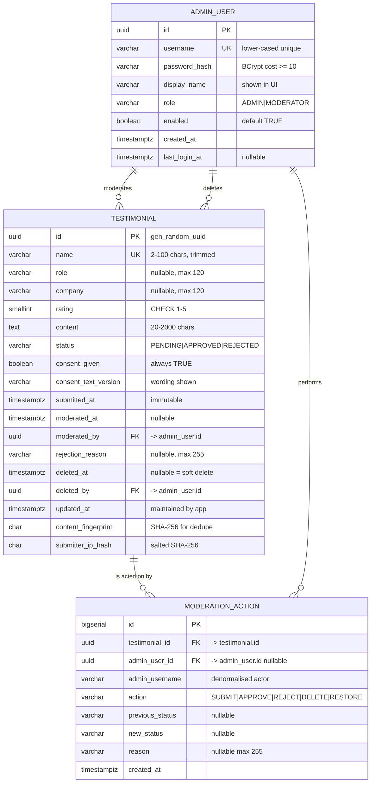

# LoveProof — Data Model

**Version:** 1.2 (implemented — V1–V4 applied and validated)
**Database:** PostgreSQL 16
**Schema owner:** `loveproof` (application user, least privilege)
**Migration tooling:** Flyway (`backend/src/main/resources/db/migration`)

---

## 1. Design Overview

The model is deliberately small. Three tables carry the product:

| Table | Purpose | Rough cardinality |
|---|---|---|
| `testimonial` | Every submission and its moderation state | 1 row per submission |
| `admin_user` | Accounts permitted to moderate | 1–N rows (1 seeded in v1) |
| `moderation_action` | Append-only audit trail of every moderation decision | 0–N rows per testimonial |

Two design rules shape everything else:

1. **Status and deletion are orthogonal.** `status` carries the moderation decision (`PENDING`,
   `APPROVED`, `REJECTED`); `deleted_at` carries the independent soft-delete flag. A deleted testimonial
   keeps its last moderation status so the audit history stays meaningful, but it is excluded from the
   wall and from every count except the explicitly labelled "deleted" count.
2. **Counts are derived, never stored.** There is no counter table and no cached aggregate. Dashboard
   numbers come from `COUNT(*)`/`AVG()` queries at request time, so they cannot drift out of sync with the
   underlying rows.

---

## 2. Entity Reference

### 2.1 `testimonial`

The core entity. One row per public submission.

| Field | Type | Null | Default | Constraints / Notes |
|---|---|---|---|---|
| `id` | `uuid` | no | `gen_random_uuid()` | PK. Client-visible opaque identifier. |
| `name` | `varchar(100)` | no | — | Trimmed on write. Length 2–100 enforced by CHECK **and** bean validation. |
| `role` | `varchar(120)` | yes | — | Job title. Trimmed; empty string normalised to `NULL`. |
| `company` | `varchar(120)` | yes | — | Trimmed; empty string normalised to `NULL`. |
| `rating` | `smallint` | no | — | CHECK `rating BETWEEN 1 AND 5`. No half-stars. |
| `content` | `text` | no | — | Plain text, 20–2000 chars, trimmed. Never rendered as HTML. |
| `status` | `varchar(16)` | no | `'PENDING'` | CHECK `IN ('PENDING','APPROVED','REJECTED')`. |
| `consent_given` | `boolean` | no | — | Must be `true` at creation (CHECK enforced at DB level). |
| `consent_text_version` | `varchar(32)` | no | — | Identifies the consent wording shown at submission time, e.g. `v1`. |
| `submitted_at` | `timestamptz` | no | `now()` | Set once on insert; never changed. |
| `moderated_at` | `timestamptz` | yes | `NULL` | Timestamp of the most recent moderation decision. |
| `moderated_by` | `uuid` | yes | `NULL` | FK → `admin_user(id)` `ON DELETE SET NULL`. |
| `rejection_reason` | `varchar(255)` | yes | `NULL` | Set when status is `REJECTED`. |
| `deleted_at` | `timestamptz` | yes | `NULL` | Soft-delete marker. `NULL` = live. |
| `deleted_by` | `uuid` | yes | `NULL` | FK → `admin_user(id)` `ON DELETE SET NULL`. |
| `updated_at` | `timestamptz` | no | `now()` | Maintained by application on every update. |
| `content_fingerprint` | `char(64)` | no | — | SHA-256 of `name` + normalised `content`. Backs the duplicate check (FR-1.13). |
| `submitter_ip_hash` | `char(64)` | yes | `NULL` | Salted SHA-256 of the client IP. Never the raw IP. |

**Derived / computed (not columns):** `averageRating` across approved testimonials, `pendingCount`,
`approvedCount`, `rejectedCount`, `deletedCount`, `last7DaysCount`.

**Deliberately absent:** `email`, `author_ip` (raw), `updated_by` on non-moderation edits, `view_count`,
`featured`, `slug`. Rationale in A-2, A-4 and A-9 of the requirements document.

#### Check constraints

| Name | Definition | Purpose |
|---|---|---|
| `ck_testimonial_rating_range` | `rating >= 1 AND rating <= 5` | Enforces the 1–5 scale at DB level. |
| `ck_testimonial_status` | `status IN ('PENDING','APPROVED','REJECTED')` | Prevents invalid states from any writer. |
| `ck_testimonial_name_length` | `char_length(btrim(name)) BETWEEN 2 AND 100` | Mirrors bean validation so non-JPA writers cannot bypass it. |
| `ck_testimonial_content_length` | `char_length(btrim(content)) BETWEEN 20 AND 2000` | Same. |
| `ck_testimonial_role_length` | `role IS NULL OR char_length(btrim(role)) <= 120` | Same. |
| `ck_testimonial_company_length` | `company IS NULL OR char_length(btrim(company)) <= 120` | Same. |
| `ck_testimonial_consent_required` | `consent_given = TRUE` | Consent can never be withdrawn by editing the row to `false`. |
| `ck_testimonial_rejection_reason` | `(status = 'REJECTED' AND rejection_reason IS NOT NULL) OR (status <> 'REJECTED')` | A rejection always carries a reason. |
| `ck_testimonial_moderation_fields` | `(status = 'PENDING' AND moderated_at IS NULL) OR (status <> 'PENDING' AND moderated_at IS NOT NULL)` | Pending means untouched. |

#### Indexes

| Index | Columns | Type | Serves |
|---|---|---|---|
| `pk_testimonial` | `id` | B-tree | PK. |
| `idx_testimonial_status_submitted` | `(status, submitted_at DESC)` | B-tree | Moderation inbox ordering; per-status counts. |
| `idx_testimonial_live_approved` | `(submitted_at DESC)` | **Partial**: `WHERE status = 'APPROVED' AND deleted_at IS NULL` | Public wall — keeps the index small regardless of queue size. |
| `idx_testimonial_rating_approved` | `(rating)` | **Partial**: `WHERE status = 'APPROVED' AND deleted_at IS NULL` | Wall filter by rating. |
| `idx_testimonial_fingerprint` | `(content_fingerprint)` | B-tree | Duplicate detection. |
| `idx_testimonial_submitter` | `(submitter_ip_hash, submitted_at DESC)` | B-tree | Per-IP rate-limit bookkeeping and abuse review. |
| `idx_testimonial_deleted_at` | `(deleted_at)` | B-tree | Fast exclusion of soft-deleted rows. |

**Composite indexes for the wall (migration `V4`).** The wall is the busiest read in the
application, and its two orderings each need the sort column together with the filter columns in
a single index. Without them the planner reads every approved row and sorts them to return the
first page.

| Index | Columns | Type | Serves |
|---|---|---|---|
| `idx_testimonial_live_approved_recent` | `(submitted_at DESC, rating DESC)` | **Partial**: `WHERE status = 'APPROVED' AND deleted_at IS NULL` | The wall's "newest first" ordering. |
| `idx_testimonial_live_approved_rating` | `(rating DESC, submitted_at DESC)` | **Partial**: `WHERE status = 'APPROVED' AND deleted_at IS NULL` | The wall's "highest rated" ordering. The submission time is the tie-breaker, so the ordering is total and two rows with the same rating always come back in the same order. |
| `idx_testimonial_live_approved_rating_filter` | `(rating, submitted_at DESC)` | **Partial**: `WHERE status = 'APPROVED' AND deleted_at IS NULL AND consent_given = TRUE` | The wall filtered by rating. |

All three share the baseline partial predicate, so they stay small however large the moderation
queue grows: a pending or deleted row is in none of them.

With these in place the wall read is a direct index scan returning exactly the rows the page
needs — 0.09 ms over 1,000 rows, against a top-N heapsort over every approved row before.
`WallPerformanceTest` asserts the plan uses an index scan and never a sequential scan.

#### Relationships

- `testimonial.moderated_by` → `admin_user.id` (many-to-one, nullable)
- `testimonial.deleted_by` → `admin_user.id` (many-to-one, nullable)
- `testimonial` → `moderation_action` (one-to-many via `moderation_action.testimonial_id`)

---

### 2.2 `admin_user`

| Field | Type | Null | Default | Constraints / Notes |
|---|---|---|---|---|
| `id` | `uuid` | no | `gen_random_uuid()` | PK. |
| `username` | `varchar(50)` | no | — | **Unique.** Case-insensitive unique (stored lower-cased). |
| `password_hash` | `varchar(100)` | no | — | BCrypt hash, cost ≥ 10. Never logged, never returned by any endpoint. |
| `display_name` | `varchar(100)` | no | — | Shown in the admin header, e.g. "Course Admin". |
| `role` | `varchar(16)` | no | `'ADMIN'` | CHECK `IN ('ADMIN','MODERATOR')`. Only `ADMIN` may log in to the admin area in v1 (A-3). |
| `enabled` | `boolean` | no | `true` | Disabled users cannot authenticate. |
| `created_at` | `timestamptz` | no | `now()` | — |
| `last_login_at` | `timestamptz` | yes | `NULL` | Updated on successful authentication. |

**Check constraints:** `ck_admin_user_role` on `role`; `ck_admin_user_password_hash` requires a
non-blank hash.

**Indexes:** `uq_admin_user_username` (unique, b-tree on `lower(username)`), `pk_admin_user`.

---

### 2.3 `moderation_action`

Append-only audit log. Rows are inserted, never updated, never hard-deleted.

| Field | Type | Null | Default | Constraints / Notes |
|---|---|---|---|---|
| `id` | `bigserial` | no | — | PK. Monotonic ordering for stable tie-breaks. |
| `testimonial_id` | `uuid` | no | — | FK → `testimonial(id)` `ON DELETE CASCADE`. |
| `admin_user_id` | `uuid` | yes | `NULL` | FK → `admin_user(id)` `ON DELETE SET NULL`. Nulled if the admin row is removed; the action text remains. |
| `admin_username` | `varchar(50)` | no | — | Denormalised copy of the actor's username, so the audit trail survives admin deletion. |
| `action` | `varchar(16)` | no | — | CHECK `IN ('SUBMIT','APPROVE','REJECT','DELETE','RESTORE')`. |
| `previous_status` | `varchar(16)` | yes | `NULL` | Status before the action, for replay/audit. |
| `new_status` | `varchar(16)` | yes | `NULL` | Status after the action. |
| `reason` | `varchar(255)` | yes | `NULL` | Rejection reason or delete note. |
| `created_at` | `timestamptz` | no | `now()` | Action timestamp. |

**Check constraints:** `ck_moderation_action_action` on the `action` vocabulary; `ck_moderation_action_status`
ensuring `previous_status`/`new_status` are `NULL` or valid status values.

**Indexes:** `idx_moderation_action_testimonial` on `(testimonial_id, created_at DESC)`;
`idx_moderation_action_created_at` on `(created_at DESC)`.

> `SUBMIT` is recorded on creation so the audit trail covers the full lifecycle, not just moderation.

---

## 3. Entity Relationship Diagram



---

## 4. Relationship Summary

| From | To | Cardinality | FK | On delete | Notes |
|---|---|---|---|---|---|
| `admin_user` | `testimonial` (as moderator) | 1 : N | `testimonial.moderated_by` | `SET NULL` | A moderator may have moderated many testimonials; deleting the admin keeps the testimonial, clearing the pointer. |
| `admin_user` | `testimonial` (as deleter) | 1 : N | `testimonial.deleted_by` | `SET NULL` | Same semantics for the soft-delete actor. |
| `testimonial` | `moderation_action` | 1 : N | `moderation_action.testimonial_id` | `CASCADE` | If a testimonial is ever hard-purged, its audit rows go with it. |
| `admin_user` | `moderation_action` | 1 : N | `moderation_action.admin_user_id` | `SET NULL` | The denormalised `admin_username` preserves the actor identity regardless. |

**No association tables.** There is no many-to-many relationship in v1: a testimonial belongs to exactly
one moderation state and is acted on by one admin at a time. `testimonial.moderated_by` and
`testimonial.deleted_by` are intentionally two separate pointers rather than one `last_actor` column,
because "who approved this" and "who deleted this" are different questions.

---

## 5. Constraint Strategy

Validation is enforced in **three layers**, so a bug in any single layer cannot corrupt the data:

| Layer | Mechanism | Covers | Examples |
|---|---|---|---|
| UI | HTML attributes + client-side validation | Immediate feedback | `required`, `minlength`, `maxlength`, `min=1 max=5` |
| API | Jakarta Bean Validation on request DTOs | Authoritative input validation, before any persistence | `@NotBlank`, `@Size`, `@Min`, `@Max`, `@AssertTrue` |
| Database | `CHECK` constraints, `NOT NULL`, FKs | Integrity regardless of which writer touched the row | `ck_testimonial_rating_range`, `ck_testimonial_consent_required` |

The API is authoritative for validation; the UI layer is a convenience and the database layer is the
guarantee.

---

## 6. Key Query Patterns

### 6.1 Public wall (FR-5)

```sql
SELECT id, name, role, company, rating, content, submitted_at
FROM testimonial
WHERE status = 'APPROVED' AND deleted_at IS NULL
  AND (:rating IS NULL OR rating = :rating)
ORDER BY submitted_at DESC          -- or: rating DESC, submitted_at DESC
LIMIT :size OFFSET :offset;
```

Served by the partial index `idx_testimonial_live_approved` for the newest-first ordering and by
the `V4` composite indexes for the ordering as it is actually run — `idx_testimonial_live_approved_recent`
for `submitted_at DESC` and `idx_testimonial_live_approved_rating` for `rating DESC, submitted_at DESC`.
With the rating filter applied, `idx_testimonial_live_approved_rating_filter` narrows the scan to a
fifth of the wall at most.

### 6.2 Dashboard counts (FR-3)

```sql
SELECT
  count(*) FILTER (WHERE deleted_at IS NULL)                                            AS total,
  count(*) FILTER (WHERE status = 'PENDING'   AND deleted_at IS NULL)                    AS pending,
  count(*) FILTER (WHERE status = 'APPROVED'  AND deleted_at IS NULL)                    AS approved,
  count(*) FILTER (WHERE status = 'REJECTED'  AND deleted_at IS NULL)                    AS rejected,
  count(*) FILTER (WHERE deleted_at IS NOT NULL)                                         AS deleted,
  count(*) FILTER (WHERE submitted_at >= now() - interval '7 days')                      AS last7days,
  round(avg(rating) FILTER (WHERE status = 'APPROVED' AND deleted_at IS NULL)::numeric, 1) AS avg_rating
FROM testimonial;
```

One round trip for the whole dashboard.

### 6.3 Moderation inbox (FR-4)

```sql
SELECT id, name, role, company, rating, left(content, 200) AS excerpt,
       status, submitted_at, rejection_reason
FROM testimonial
WHERE (:status IS NULL OR status = :status)
  AND deleted_at IS NULL
  AND (:q IS NULL OR name ILIKE :q OR company ILIKE :q OR content ILIKE :q)
ORDER BY submitted_at DESC
LIMIT :size OFFSET :offset;
```

### 6.4 Duplicate detection (FR-1.13)

```sql
SELECT 1 FROM testimonial
WHERE content_fingerprint = :fingerprint
  AND submitted_at > now() - interval '10 minutes'
LIMIT 1;
```

---

## 7. Migration Plan (Flyway)

| Version | File | Contents |
|---|---|---|
| `V1__baseline.sql` | `V1__baseline.sql` | Extensions (`pgcrypto` for `gen_random_uuid`), `testimonial`, `admin_user`, `moderation_action` tables, all CHECK constraints, all FKs, all indexes. |
| `V2__seed_admin_user.sql` | `V2__seed_admin_user.sql` | Seed the local admin account (idempotent `INSERT ... ON CONFLICT (lower(username)) DO NOTHING`). Password hash injected from a configurable property placeholder so no secret lives in the repository. |
| `V3__resync_admin_user.sql` | `V3__resync_admin_user.sql` | Resynchronise the seeded admin row when the configured hash differs from the stored one. |
| `V4__wall_composite_indexes.sql` | `V4__wall_composite_indexes.sql` | Three partial composite indexes for the public wall: the newest-first ordering, the highest-rated ordering, and the rating filter. |

`ddl-auto` is set to `validate` in every profile: Flyway owns the schema and Hibernate may only verify it.

> **Flyway placeholders and `$`.** A BCrypt hash contains `$` characters, which Flyway reads as the
> start of a placeholder. The hash is therefore written with `${dollar}` in the migration and in the
> YAML, and `dollar: '$'` is declared under `spring.flyway.placeholders`. Changing either the
> migration or the placeholder without the other breaks the seed.

> **Never put a `${...}` default inside a YAML default value.** Spring resolves those, and Spring
> does not know about the `dollar` placeholder — the literal text `${dollar}` reaches the database.
> The hash is read from a `loveproof.admin.*` property instead, which is what `V3` resynchronises
> against.

> **Applied migrations are immutable.** Flyway validates the checksum of every applied migration on
> boot, so even a comment edit breaks the next start. A correction goes in a new numbered migration.

> **Entity mapping notes.** The two fixed-width columns (`content_fingerprint`, `submitter_ip_hash`)
> are mapped with `@JdbcTypeCode(SqlTypes.CHAR)`, because Hibernate's `validate` compares the JDBC
> type against the PostgreSQL `bpchar` type and would otherwise report a mismatch.

---

## 8. Migration & Evolution Notes

| Concern | Approach |
|---|---|
| Adding a new status value | Extend `ck_testimonial_status` in a new migration (`V3__...`), never edit `V1`. |
| Splitting `role`/`company` later | Already separate columns — no migration needed. |
| Adding email | Nullable column + a new CHECK; the API contract changes are additive. |
| Purging soft-deleted rows | `DELETE FROM testimonial WHERE deleted_at < now() - interval '...'`, plus a scheduled job — supported by the current schema, out of scope for v1 (A-15). |
| Splitting roles into real permissions | `admin_user.role` exists for exactly this; add a permission table when needed. |
| Full-text search | Current `ILIKE` search is adequate at v1 scale; `tsvector` + GIN index is the upgrade path. |

---

## 9. Data Volume & Lifecycle Expectations

| Metric | v1 expectation | Behaviour at 10× |
|---|---|---|
| Testimonials | 100 – 10,000 | Partial index keeps the wall query flat; pagination prevents full scans. |
| Admin users | 1 – 10 | Trivial. |
| Moderation actions | ~3–10 per testimonial | Append-only; indexed by testimonial for history lookups. |
| Growth characteristics | Linear in reads | All hot queries are index-backed; no table scans on the public path. |

---

## 10. Related Documents

- [`docs/requirements.md`](./requirements.md) — functional and non-functional requirements.
- [`docs/implementation-plan.md`](./implementation-plan.md) — phased build plan with acceptance criteria.
